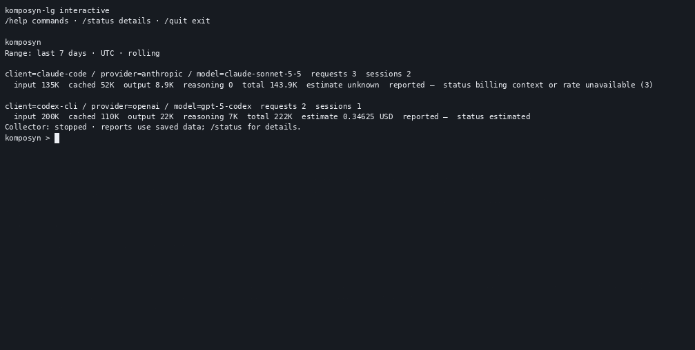

<div align="center">

# komposyn-lg

**Your AI coding usage. One local history.**

[](https://github.com/ayeshLK/komposyn-lg/releases/latest) [](https://github.com/ayeshLK/komposyn-lg/actions/workflows/ci.yml) [](LICENSE)

[Install](#install) · [First report](#first-useful-report) · [Uninstall](#uninstall) · [Documentation](docs/README.md) · [Contributing](CONTRIBUTING.md)

</div>

`komposyn-lg` (pronounced “composing log”) is for developers who use Codex and
Claude Code across projects and want to see where their token usage goes. It
imports supported local records into one history you can explore by project,
session, and model from your terminal.

Provider files are read-only. `komposyn-lg` stores usage metadata and does not
capture prompts, responses, or credentials by default. It has no telemetry.

Cost estimates use a bundled pricing catalog. They are public list-price
estimates, not invoices; missing pricing evidence remains unknown. See
[usage and cost reporting](docs/usage.md#reports) for coverage and limitations.

<div align="center">

### komposyn-lg in action

The REPL demo uses **komposyn-lg v0.9.0**.



</div>

## Install

Signed stable releases are published for **Linux, macOS, and Windows**, on both
**amd64 (x86-64) and arm64**. You do not need Go to install a release.

The installers resolve the **latest stable release**, select your platform, and
verify the archive's SHA-256 checksum and Cosign signature before installing it.

### macOS and Linux

Requires Bash, `curl`, `jq`, `tar`, `sha256sum` or `shasum`, and
[Cosign](https://docs.sigstore.dev/cosign/system_config/installation/), available
on your `PATH`.

```sh
curl -fsSL https://raw.githubusercontent.com/ayeshLK/komposyn-lg/master/scripts/install.sh | bash
```

The default installation directory is `~/.local/bin`. If it is not already on
your `PATH`, add this line to your shell configuration and open a new terminal:

```sh
export PATH="$HOME/.local/bin:$PATH"
```

### Windows (PowerShell)

Requires PowerShell and
[Cosign](https://docs.sigstore.dev/cosign/system_config/installation/) on your
`PATH`.

```powershell
$d = Join-Path $env:TEMP ([guid]::NewGuid()); New-Item -ItemType Directory -Path $d | Out-Null; try { Invoke-WebRequest -Uri https://raw.githubusercontent.com/ayeshLK/komposyn-lg/master/scripts/install.ps1 -OutFile (Join-Path $d 'install.ps1'); Invoke-WebRequest -Uri https://raw.githubusercontent.com/ayeshLK/komposyn-lg/master/scripts/windows-architecture.ps1 -OutFile (Join-Path $d 'windows-architecture.ps1'); & (Join-Path $d 'install.ps1') } finally { Remove-Item -LiteralPath $d -Recurse -Force }
```

The default installation directory is `$env:LOCALAPPDATA\Komposyn\bin`. Add
that directory to your user `PATH` and open a new terminal. The installer
downloads `windows-architecture.ps1` beside `install.ps1`; keep both files
together so the helper can select the native Windows ARM64 release when needed.
To use the installed command in the current PowerShell session:

```powershell
$env:Path = "$env:LOCALAPPDATA\Komposyn\bin;$env:Path"
```

### Check your installation

```sh
komposyn-lg version
komposyn-lg --help
```

For a pinned version, a custom install directory, local release artifacts, or
manual verification, see the [installation guide](docs/installation.md) and
[release verification guide](docs/release-verification.md). You can also browse
all [release downloads and notes](https://github.com/ayeshLK/komposyn-lg/releases).
If you build from source, run `./bin/komposyn-lg` from the repository root;
the command examples below otherwise assume the installed `komposyn-lg` is on
your `PATH`.

## First useful report

Run the interactive interface:

```sh
komposyn-lg
```

On first use, onboarding asks whether to start the local collector now and
whether to start it automatically on future REPL launches. Collection is opt-in
and reads configured Codex and Claude Code source directories without
changing them. The first scan is asynchronous. Run `/status` and check
`last_completed` and source counts. If `last_completed` is not available yet,
run `/status` again later, or press Enter to return through a prompt boundary
and then inspect status. Once a scan has completed, run `/total-usage` (or
`/refresh`) to query committed data:

```text
/total-usage
```

Explore a project and its sessions using row numbers shown in the current
tables:

```text
/projects
/project 1
/sessions
/session 1
/models
/model 1
```

The `1` selectors above are examples: choose a row from the table currently
shown. Use `/back` or `/home` to move to a broader view. The first report may
be empty if no supported usage has been collected yet; see the
[getting started guide](docs/getting-started.md) for manual import.

For exact token integers or machine-readable output, run JSON or CSV export from
a shell after leaving the interactive view:

```sh
komposyn-lg usage --group-by project,model --format json > usage.json
komposyn-lg sessions --format csv > sessions.csv
```

Reported costs remain separate from public list-price estimates. Estimates are
not invoices, and missing pricing evidence remains unknown.

## Upgrade

Download and run the installer again to install the latest stable release.
Upgrades preserve your database, settings, consent choices, and registered sources.
An active managed collector is stopped before replacement; a previously running
background collector is restarted. Foreground and interactive collectors need
manual resumption, as explained by the installer.

If you use a custom installation directory or data directory, set
`KOMPOSYN_INSTALL_DIR` and `TOKEN_LOGGER_DATA_DIR` to those same locations when
running install or uninstall scripts. See [upgrades](docs/upgrades.md) for details.

## Uninstall

Use the uninstall script for your platform. It stops a managed collector before
removing the executable and **preserves your local usage history and settings**.

**macOS and Linux:**

```sh
curl -fsSL https://raw.githubusercontent.com/ayeshLK/komposyn-lg/master/scripts/uninstall.sh | bash
```

**Windows (PowerShell):**

```powershell
Invoke-RestMethod https://raw.githubusercontent.com/ayeshLK/komposyn-lg/master/scripts/uninstall.ps1 | Invoke-Expression
```

New installations store data in `$HOME/.komposyn/token-logger/data` (under the
user profile on Windows); existing legacy data directories are supported.
`TOKEN_LOGGER_DATA_DIR` or `--data-dir` selects a different location. If you also
want to remove your history, first review [backups](docs/backups.md) and
[data-directory configuration](docs/configuration.md). Provider-owned transcripts
are never removed by these scripts.

## Documentation

| Goal | Guide |
| --- | --- |
| Learn the commands and output formats | [CLI reference](docs/cli-reference.md) |
| Configure data paths, collection, and consent | [Configuration](docs/configuration.md) |
| Understand reports and pricing | [Usage guide](docs/usage.md) |
| Diagnose collection problems | [Troubleshooting](docs/troubleshooting.md) |
| Connect a host application | [JSONL harness protocol v1](docs/HARNESS_PROTOCOL.md) |
| Understand local data handling | [Privacy](docs/privacy.md) and [security model](docs/security-model.md) |

See the [documentation index](docs/README.md) for the full guide.

## Development and contributing

Bug reports, documentation improvements, and code contributions are welcome.
Start with [CONTRIBUTING.md](CONTRIBUTING.md) and the
[development guide](docs/contributing/development.md) for setup and checks.

To build from source, install Go **1.26.9 or newer**:

```sh
git clone https://github.com/ayeshLK/komposyn-lg.git
cd komposyn-lg
make build
./bin/komposyn-lg --help
```

This repository owns the CLI, interactive experience, settings, and process
lifecycle. The separately versioned [KompoSyn core](https://github.com/ayeshLK/komposyn)
owns the reusable model, SQLite storage, provider adapters, pricing, and reports.
`komposyn-lg version` displays both the CLI and core versions.

For installation feedback or a reproducible bug,
[open an issue](https://github.com/ayeshLK/komposyn-lg/issues) with your CLI
version, operating system, command, sanitized output, and steps to reproduce.
Do not attach provider transcripts, prompts, responses, credentials, private
paths, or raw diagnostics. For code or documentation contributions, start with
[CONTRIBUTING.md](CONTRIBUTING.md). Report vulnerabilities privately using
[SECURITY.md](SECURITY.md).

## License

[Apache License 2.0](LICENSE). See [NOTICE](NOTICE) for attribution.
