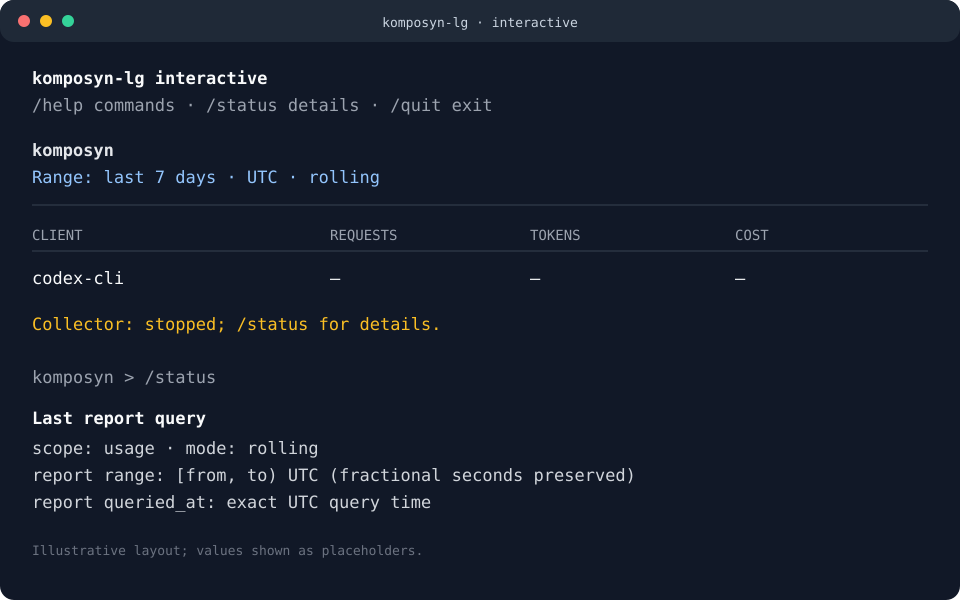

# REPL information hierarchy

Issue [#33](https://github.com/ayeshLK/komposyn-lg/issues/33) concerns the
information surrounding the usage tables. Projects → sessions → models remains
the navigation model. The following inventory drives the presentation changes.

| Information | Default experience | Detail command |
| --- | --- | --- |
| Product identity and command discovery | Brief banner with help, status, exit | `/help` |
| Project/session/model context | Breadcrumb and scoped prompt | Existing navigation commands |
| Tokens, requests, costs, missing pricing | Existing report tables and summaries | `/pricing` for coverage explanations |
| Time range | Rolling seven days or explicit pinned bounds, labeled UTC | `/status` for exact last-report bounds; `/range` for effective range |
| CLI and core versions | On request | `/status` |
| Data directory | On request | `/status`, `/settings` |
| Collector startup reason and saved preferences | On request | `/status`, `/settings` |
| Collector lifecycle and accounting concerns | One short notice when its meaning changes | `/status` |
| Scan timestamps, counters, runtime interval | On request | `/status` |
| Database query timestamp | On request; distinct from scan completion | `/status` |
| Setup/query errors and diagnostic consent | Existing visible errors and explicit consent flow | `/report-issue` for pending diagnostics |
| Editing/submission guidance | Existing terminal-specific hint | `/help` and usage guide |

## Research and decisions

Official documentation reviewed on 2026-10-19:

- [SQLite CLI](https://www.sqlite.org/cli.html) describes a brief startup banner
  and dedicated commands for help, database details, and versions. Apply the
  brief introduction and explicit inspection commands here.
- [PostgreSQL psql](https://www.postgresql.org/docs/current/app-psql.html)
  provides `\conninfo` for connection details and configurable prompts and
  result formatting. Keep scope visible in the prompt; make environment details
  available separately from report results.
- [IPython magics](https://ipython.readthedocs.io/en/stable/interactive/magics.html)
  exposes configuration through `%config` and reference help through `%quickref`.
  Keep help and inspection easy to discover without printing their full contents
  at startup.

These are design inferences from the tools, rather than a requirement that
KompoSyn adopt their command syntax. Plain text and whitespace provide the
hierarchy across terminals, narrow windows, and piped interactive input.

## Resulting layout



```text
komposyn-lg interactive
/help commands · /status details · /quit exit

komposyn
Range: last 7 days · UTC · rolling

<existing usage table and cost summary>
Collector: running; /status for details.
komposyn >
```

The terminal-specific input hint still appears where needed. Pinned date ranges
show dates; sub-day ranges retain exact timestamp precision. Collection notices
retain stale/degraded lifecycle, pending data, no discovered sources after a
completed scan, and recorded accounting failures. Counter values and timestamps
do not trigger repeated notices. Recovery changes the lifecycle notice; earlier
failure counts remain explicitly described as recorded warnings.

`/status` separates identity/location, collection, the last report query, and
privacy policy. Last-report metadata is copied after a successful database query
so inspection cannot shift its rolling bounds. An unsuccessful later query does
not overwrite that metadata. `/pricing` and `/range` retain their existing
explicit inspection behavior. `/refresh` continues to query committed data
without starting or waiting for collection.

Example detail view:

```text
Status
  komposyn-lg 0.8.2 (core 0.8.0)
  data directory: <selected data directory>

Collection
  session: session-owned collector started from saved auto-start preference
  saved collector enabled preference: true
  saved collector auto-start on REPL launch: true
  saved collector poll interval: 5s
  collector lifecycle: state=running; mode=embedded; stale=false
  source scan: last_poll=<UTC>; last_completed=<UTC>; discovered=2; registered=2; discovery_failures=0; pending=false
  runtime: interval=5s; started=<UTC>; heartbeat=<UTC>; stopped=unavailable; stop_requested=unavailable
  accumulated outcomes: imported=4; duplicates=0; ignored_non_usage=2; unchanged_snapshot=0; deferred_incomplete_tail=0; unsupported_usage=0; malformed_record=0; failed_source=0
  Counters are accumulated for this collector run; lifecycle does not prove a source scan completed.

Last report query
  scope: komposyn / project:Example
  mode: rolling
  report range: 2026-10-12T10:00:00Z to 2026-10-19T10:00:00Z (UTC)
  report queried_at: 2026-10-19T10:00:00.123456789Z
  Bounds are half-open [from, to). Reports query saved database data; source scanning is separate.
  /refresh redraws committed data without starting or waiting for a scan.

Privacy
  diagnostic reporting: ask before any external action
```

## Review scenarios

Review startup with collection disabled, a new asynchronous collector, and an
existing background collector. Check normal polling, pending data, degradation,
recovery, stale leases, and no discovered sources. Inspect `/status` after idle
time, navigation, a failed query, and a fractional-second pinned range. Browse
projects → sessions → models and confirm the report stays visually dominant.
Check narrow terminals and Windows submission hints. Consent prompts and
noninteractive JSON/CSV/harness output must preserve their existing behavior.
